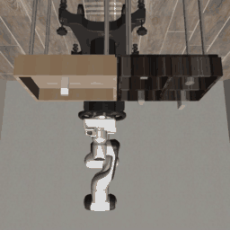

# robosuite — Enhanced Edition

[](https://github.com/aruninf/robosuite)
[](https://www.python.org/)
[](https://mujoco.org/)
[](LICENSE)


[**[Homepage]**](https://robosuite.ai/) &ensp; [**[White Paper]**](https://arxiv.org/abs/2009.12293) &ensp; [**[Documentations]**](https://robosuite.ai/docs/overview.html) &ensp; [**[GitHub @aruninf]**](https://github.com/aruninf/robosuite)

---

## 🎬 Featured Interactive Demos

### 1. Autonomous Smooth Pick-and-Place into Bucket
Autonomous, closed-loop manipulation demonstration. The robot smoothly identifies the object on the table, descends, grasps with force control, lifts, carries across the workspace, and cleanly drops the item into its corresponding bucket.

<p align="center">
  
  <br>
  <em>Autonomous Franka Panda arm performing pick-and-place into target bin with S-curve trajectory smoothing. Full HD video available in <a href="docs/images/demo_pick_and_drop.mp4">docs/images/demo_pick_and_drop.mp4</a>.</em>
</p>

```bash
# Run with on-screen 3D viewer (on macOS use mjpython):
mjpython robosuite/demos/demo_pick_and_place.py

# Select object (milk, bread, cereal, can) and robot:
mjpython robosuite/demos/demo_pick_and_place.py --object milk --robots Panda
```

**Interactive Controls (in Terminal):**
- `[Space]`: Pause / Resume simulation
- `[C]`: Cycle camera perspectives (Frontview, Birdview, Eye-in-hand, Free Orbit)
- `[R]`: Reset & replay immediately
- `[Q]` / `[Esc]`: Clean exit

---

### 2. Multi-Mode Action Explorer
Explore 6 distinct motion profiles in real-time with continuous trajectory blending and live terminal HUD:

```bash
mjpython robosuite/demos/demo_random_action.py --environment Lift --robots Baxter --mode wave
```

| Mode | Key | Description |
|---|---|---|
| **Smooth** | `[1]` | Continuous Ornstein-Uhlenbeck random walk (fluid, organic exploration) |
| **Wave** | `[2]` | Synchronized harmonic sinusoidal waving across all joints / bimanual arms |
| **Reach** | `[3]` | Pick & lift cycle (reach down, grasp, lift up, open, return) |
| **Circle** | `[4]` | 3D Cartesian circular orbit with vertical breathing |
| **Jitter** | `[5]` | Bounded raw random noise (original baseline) |
| **Hold** | `[6]` | Zero action / stationary position hold |

---

## Latest Updates

- **[Enhanced Edition by @aruninf]**:
  - Added autonomous closed-loop **Pick and Drop into Bucket** demo (`demo_pick_and_place.py`).
  - Added **Multi-Mode Smooth Action Controller** with real-time hotkeys (`demo_random_action.py`).
  - Added non-blocking terminal controls (`[Space]` pause, `[M]` mode cycle, `[C]` camera switch).
  - Fixed test runner collection crashes and added Python 3.12+ compatibility refinements.
- [10/28/2024] **v1.5**: Added support for diverse robot embodiments (including humanoids), custom robot composition, composite controllers (including whole body controllers), more teleoperation devices, photo-realistic rendering. [[release notes]](https://github.com/ARISE-Initiative/robosuite/releases/tag/v1.5.0)
- [11/15/2022] **v1.4**: Backend migration to DeepMind's official [MuJoCo Python binding](https://github.com/deepmind/mujoco), robot textures, and bug fixes :robot: [[release notes]](https://github.com/ARISE-Initiative/robosuite/releases/tag/v1.4.0)

---

## Overview

**robosuite** is a modular simulation framework powered by the [MuJoCo](http://mujoco.org/) physics engine for robot learning. It offers a suite of benchmark environments and modular APIs for reproducible research:

* **standardized tasks**: a set of standardized manipulation tasks of large diversity and varying complexity;
* **procedural generation**: modular APIs for programmatically creating new environments, arenas, and parameterized 3D objects;
* **robot controllers**: joint-space velocity, inverse kinematics (IK), operational space (OSC), and whole body controllers (WBC);
* **teleoperation devices**: keyboard, SpaceMouse, and MuJoCo GUI drag-and-drop;
* **multi-modal sensors**: low-level physical states, RGB cameras, depth maps, and proprioception;
* **human demonstrations**: utilities for collecting, replaying, and learning from demonstration datasets (compatible with [robomimic](https://arise-initiative.github.io/robomimic-web/));
* **photorealistic rendering**: integration with advanced graphics tools, including NVIDIA Isaac Sim rendering.

---

## Installation & Setup

```bash
# Clone the repository
git clone https://github.com/aruninf/robosuite.git
cd robosuite

# Create virtual environment
python3 -m venv .venv
source .venv/bin/activate

# Install robosuite
pip install -e .
```

> **Note for macOS Users:** On macOS, the MuJoCo GUI viewer requires running scripts with `mjpython` instead of `python`:
> ```bash
> mjpython robosuite/demos/demo_pick_and_place.py
> ```

---

## Citation
Please cite the original [**robosuite**](https://robosuite.ai) benchmark:
```bibtex
@inproceedings{robosuite2020,
  title={robosuite: A Modular Simulation Framework and Benchmark for Robot Learning},
  author={Yuke Zhu and Josiah Wong and Ajay Mandlekar and Roberto Mart\'{i}n-Mart\'{i}n and Abhishek Joshi and Soroush Nasiriany and Yifeng Zhu and Kevin Lin},
  booktitle={arXiv preprint arXiv:2009.12293},
  year={2020}
}
```
